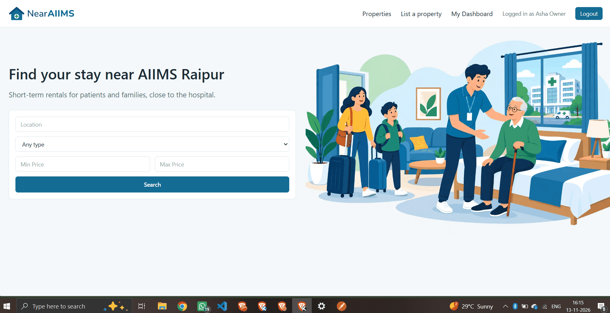
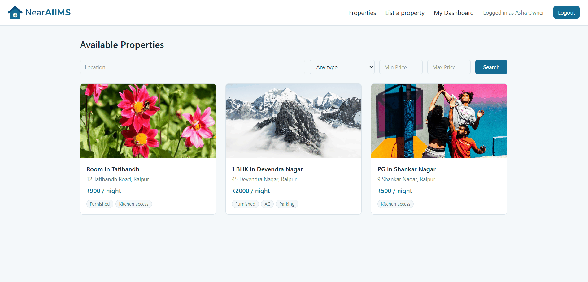
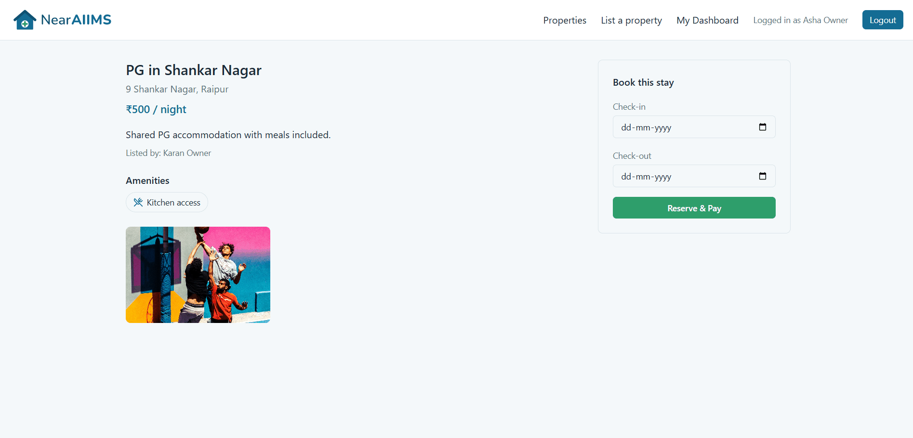
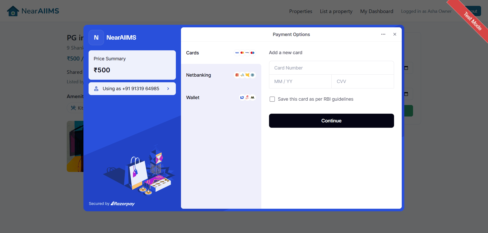
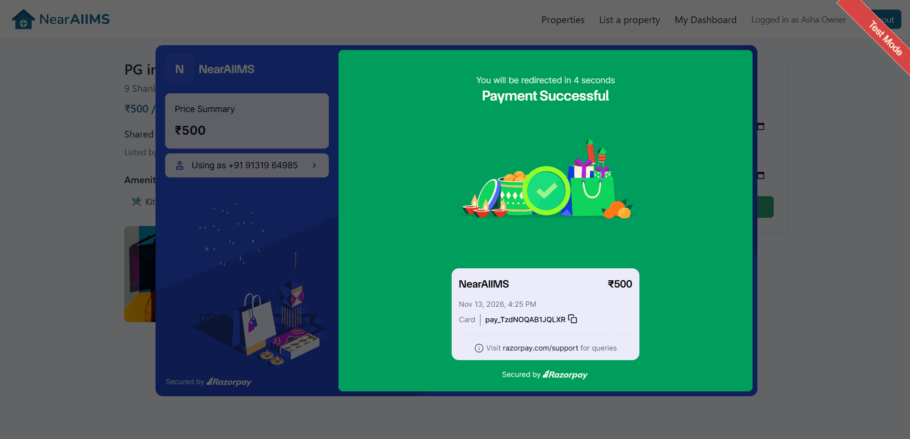
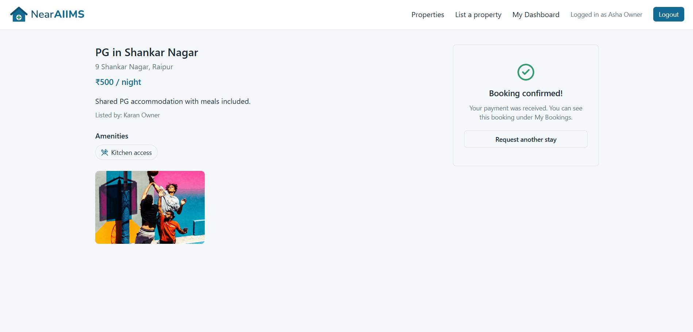
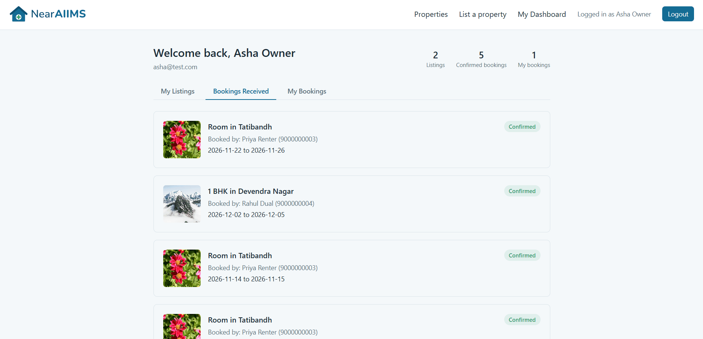
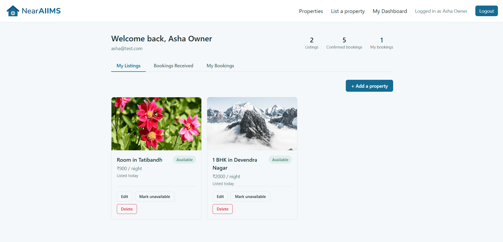

# NearAIIMS

A MERN-stack platform connecting patients and families visiting AIIMS Raipur for treatment with owners renting short-term homes nearby — with Razorpay payments in test mode.

<table>
<tr>
<td><br/><sub>Home page</sub></td>
<td><br/><sub>Browse properties</sub></td>
<td><br/><sub>Property detail &amp; booking</sub></td>
</tr>
</table>

## Problem

Many patients traveling to AIIMS Raipur for treatment (often for weeks or months) struggle to find affordable, trustworthy short-term housing close to the hospital. NearAIIMS bridges that gap by connecting them directly with local homeowners.

## Features

- User registration and login with JWT-based authentication, stored in httpOnly cookies
- Password hashing with bcrypt
- Property listings with image uploads, stored on Cloudinary
- Search and filter properties by location, property type, and price range
- Instant reservation flow: a renter reserves dates and pays immediately, no owner approval step — the server recomputes the price, checks for date conflicts against confirmed bookings, and creates a Razorpay order before saving the booking
- Razorpay Checkout integration (test mode), with server-side signature verification before any booking is confirmed
- Idempotent webhook handler for `payment.captured` and `payment.failed` — a closed browser tab, a duplicate delivery, or an out-of-order event can never leave a paid booking unconfirmed or corrupt its state
- A separate `Transaction` collection keeps a full payment history (order created, captured, failed) distinct from each booking's current state
- Owner dashboard with three views: My Listings, Bookings Received (confirmed/paid bookings only), and My Bookings
- Listing management: edit, toggle availability, and delete, each with appropriate confirmation/feedback
- Owner contact number is hidden from public listing views and only revealed to a renter once their booking is confirmed (paid)
- Ownership-based authorization on every protected route (users can only modify their own listings/bookings)
- Centralized error handling via a custom `AppError` class and a single error-handling middleware
- React frontend with client-side routing (React Router)
- Global authentication state via React Context, persisted across page refreshes
- Protected frontend routes that redirect unauthenticated users to login
- Seed script for generating realistic test data, guarded to only ever run against the local development database

## Payments

Payments run entirely in Razorpay **test mode** — no real money moves at any point.

1. A renter picks dates and clicks **Reserve & Pay**. The server recomputes the price from the listing itself (a client-sent amount is never trusted), checks for a date conflict against any _confirmed_ booking, and creates a Razorpay order.
2. Razorpay Checkout opens in the browser, and the renter pays with a test card.
3. On success, the browser calls a `verify` route, which checks the payment's signature and confirms the booking — mainly for fast UI feedback.
4. Independently, Razorpay calls a **webhook** directly on the server for `payment.captured` / `payment.failed`. This is the actual source of truth: even if the renter closes the tab immediately after paying, the webhook alone confirms the booking.
5. Every webhook handler is idempotent, so a duplicate or out-of-order delivery can never corrupt a booking's state — verified by deliberately blocking the `verify` call in the browser and confirming the webhook alone still closes the loop.

<table>
<tr>
<td><br/><sub>Razorpay Checkout (test mode)</sub></td>
<td><br/><sub>Test payment succeeded</sub></td>
<td><br/><sub>Booking confirmed</sub></td>
</tr>
</table>

## Tech Stack

**Frontend:** React, Vite, React Router, Axios, Context API, Tailwind CSS

**Backend:** Node.js, Express, MongoDB, Mongoose

**Payments:** Razorpay (test mode) — Checkout, signature verification, webhooks

**Auth:** JWT, bcrypt, httpOnly cookies

**File uploads:** Multer, Cloudinary

## Project Structure

Near-AIIMS-Fresh/
├── client/ # React frontend (Vite)
│ └── src/
│ ├── context/ # AuthContext — global auth state
│ ├── pages/ # Login, Register, Dashboard, PropertyDetail, and other route-level pages
│ ├── utils/ # loadRazorpay — loads Razorpay Checkout script on demand
│ └── components/ # Reusable components (e.g. ProtectedRoute)
└── server/ # Express backend
├── config/ # Database connection, Cloudinary config, Razorpay config (lazy, test-key-only)
├── middleware/ # requireAuth, upload (multer + Cloudinary storage), errorHandler
├── models/ # User, Property, Booking, Transaction (Mongoose schemas)
├── routes/ # authRoutes, propertyRoutes, bookingRoutes, paymentRoutes, webhookRoutes
├── utils/ # AppError, pricing (amounts/date helpers), signature (HMAC verification)
└── seed.js # Populates the database with test users, properties, and bookings (dev database only)

## Setup

### Prerequisites

- Node.js installed
- A MongoDB Atlas connection string (or local MongoDB instance)
- A Cloudinary account (free tier is sufficient) — needed for image uploads
- A Razorpay account with **test mode** API keys (free, no business verification needed) — needed for payments

### Backend

```bash
cd server
npm install
```

Create a `.env` file in `server/` with:

MONGO_URI=your_mongodb_connection_string
JWT_SECRET=your_jwt_secret
PORT=5000
NODE_ENV=development
CLOUDINARY_CLOUD_NAME=your_cloudinary_cloud_name
CLOUDINARY_API_KEY=your_cloudinary_api_key
CLOUDINARY_API_SECRET=your_cloudinary_api_secret
RAZORPAY_KEY_ID=rzp_test_your_key_id
RAZORPAY_KEY_SECRET=your_key_secret
RAZORPAY_WEBHOOK_SECRET=your_webhook_secret

`RAZORPAY_KEY_ID` must start with `rzp_test_` — the app refuses any other prefix, so a live key can never be used by accident.

Run the server:

```bash
npm run dev
```

Optionally, populate the database with test data (creates sample users, properties with real photos, and bookings across every payment status):

```bash
npm run seed
```

The seed script refuses to run against any database except `stayfinder_dev`, as a safeguard against accidentally wiping production data.

For local webhook testing, Razorpay needs a public HTTPS URL. Use a tunnel such as [ngrok](https://ngrok.com) (`ngrok http 5000`) and register the forwarded URL plus `/api/webhooks/razorpay` as a webhook in the Razorpay dashboard (test mode).

### Frontend

```bash
cd client
npm install
npm run dev
```

The frontend runs on Vite's default port (typically `5173`) and talks to the backend at `http://localhost:5000`.

## API Overview

| Method | Route                    | Description                                                                  | Auth required |
| ------ | ------------------------ | ---------------------------------------------------------------------------- | ------------- |
| POST   | `/api/auth/register`     | Create a new user                                                            | No            |
| POST   | `/api/auth/login`        | Log in, sets auth cookie                                                     | No            |
| POST   | `/api/auth/logout`       | Log out, clears auth cookie                                                  | No            |
| GET    | `/api/auth/me`           | Get current logged-in user                                                   | Yes           |
| GET    | `/api/properties`        | List properties, supports filters                                            | No            |
| GET    | `/api/properties/mine`   | List the logged-in user's own listings                                       | Yes           |
| GET    | `/api/properties/:id`    | Get one property (owner's contact number included only if requester owns it) | No            |
| POST   | `/api/properties`        | Create a property listing                                                    | Yes           |
| PUT    | `/api/properties/:id`    | Update a listing (owner only)                                                | Yes           |
| DELETE | `/api/properties/:id`    | Delete a listing (owner only)                                                | Yes           |
| POST   | `/api/bookings/reserve`  | Reserve dates and create a Razorpay order (recomputes price server-side)     | Yes           |
| GET    | `/api/bookings/mine`     | Bookings made as a renter (owner's contact number included once confirmed)   | Yes           |
| GET    | `/api/bookings/received` | Paid bookings (confirmed/cancelled/refunded) on properties owned             | Yes           |
| POST   | `/api/payments/verify`   | Verify a Razorpay payment signature and confirm the booking                  | Yes           |
| POST   | `/api/webhooks/razorpay` | Razorpay webhook — confirms/fails bookings; signature-checked, idempotent    | No (signed)   |

## Status

Payment integration with Razorpay (test mode) is complete: reserve → pay → verify/webhook → confirmed, with idempotent webhook handling and a full Transaction audit trail. Backend (auth, properties, bookings, payments, Cloudinary image storage) and frontend (auth flow, protected routes, browse/filter, property detail with Razorpay Checkout, full owner dashboard) are complete.

<table>
<tr>
<td><br/><sub>Owner dashboard — bookings received</sub></td>
<td><br/><sub>Owner dashboard — my listings</sub></td>
</tr>
</table>

## Known Limitations

- Two renters can both start a (separate) payment for the same dates before either pays; only confirmed bookings block dates, so whichever payment is captured first wins. A soft hold on reserved-but-unpaid dates is planned but not yet built.
- A renter who closes the Razorpay popup without paying, or whose payment fails, is left with a `payment_pending` / `payment_failed` booking with no way to retry from the UI yet — a "Pay now" retry route is planned.
- No cancellation or refund flow yet; owners see "Amount earned" for a confirmed booking, but payouts are recorded only, never actually transferred (by design — this project stays entirely in Razorpay test mode).
